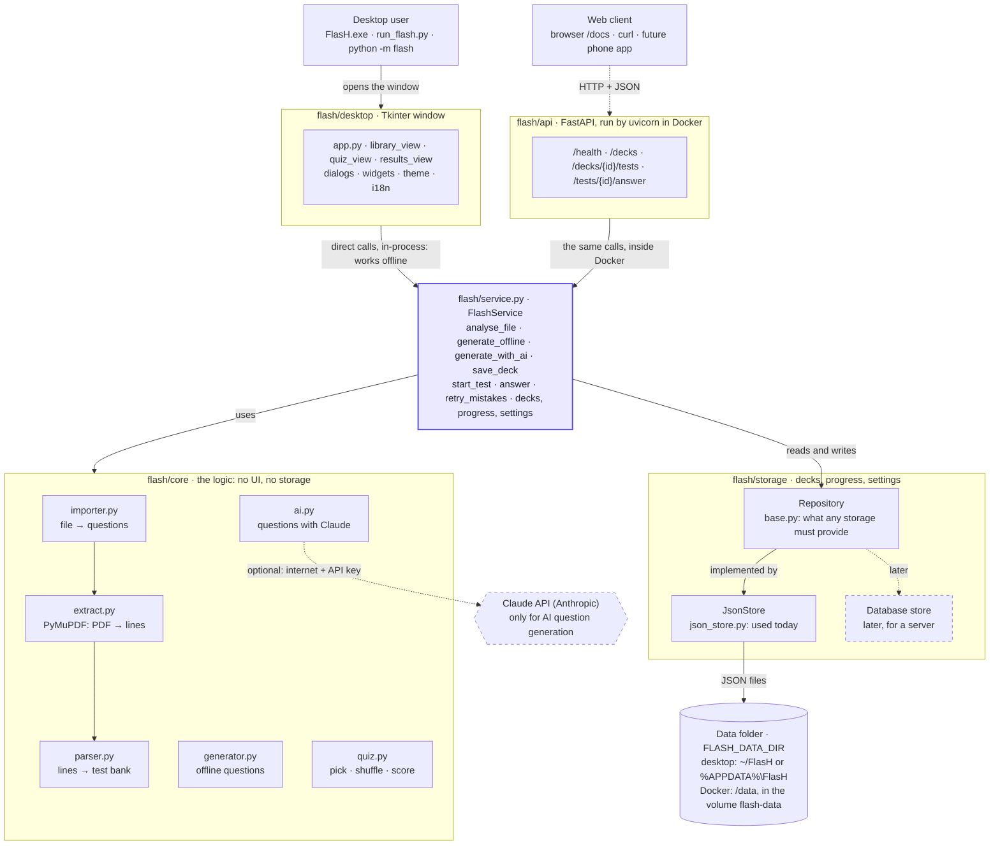
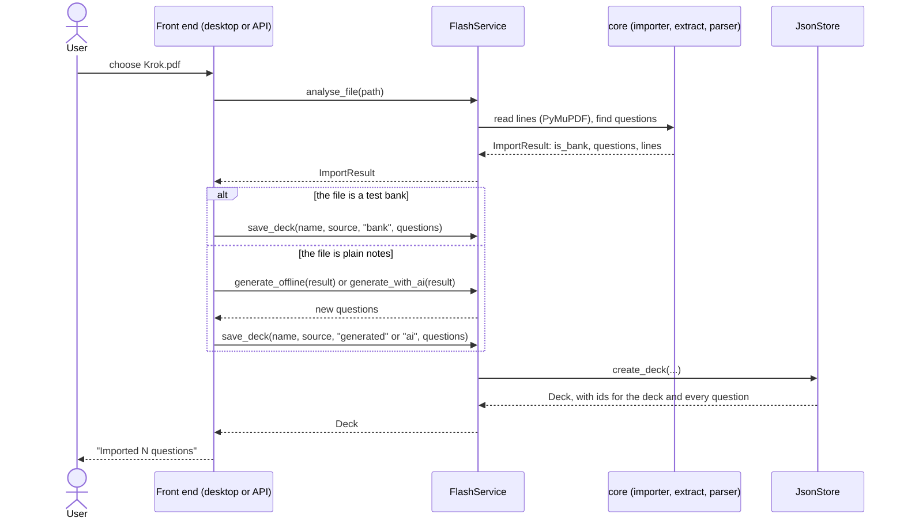
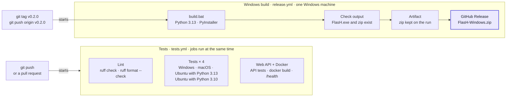

# FlasH architecture

FlasH has one "brain" and two front ends. The desktop app and the web API both go through `FlashService`, so they share the same logic. Only the web API needs a network.

- **The desktop app stays offline.** The Tkinter window calls the service directly, inside the same program. No server is involved.
- **The web API reuses the brain.** FastAPI, running in Docker, calls the same service methods, so a fix to the parser helps both.
- **Storage can be swapped.** The service only knows the `Repository` interface: JSON files today, a database later.

## How the code is organised

Solid arrows are calls inside one program. Dashed arrows go over the network or aren't built yet. Each deployment runs its own copy of this code with its own data folder, and the desktop app never talks to the server.

| Folder | What it holds | Knows about the UI? | Knows about storage? |
|---|---|---|---|
| `flash/core` | reading files, parsing test banks, generating questions, quiz rules | no | no |
| `flash/storage` | the `Repository` interface and `JsonStore` | no | yes |
| `flash/service.py` | `FlashService`, the one entry point to the logic | no | only through `Repository` |
| `flash/desktop` | the Tkinter app, one module per screen | yes | no |
| `flash/api` | the optional web API | HTTP only | no |

## What happens when you import a file

The front end decides what to show, such as the "offline or AI?" dialog on the desktop. The service decides what happens to the data.

## What GitHub runs

A branch push that changes `build.bat`, `requirements.txt`, `run_flash.py` or `packaging/` runs the same Windows build but stops at the artifact. Only a `v*` tag publishes a release.
