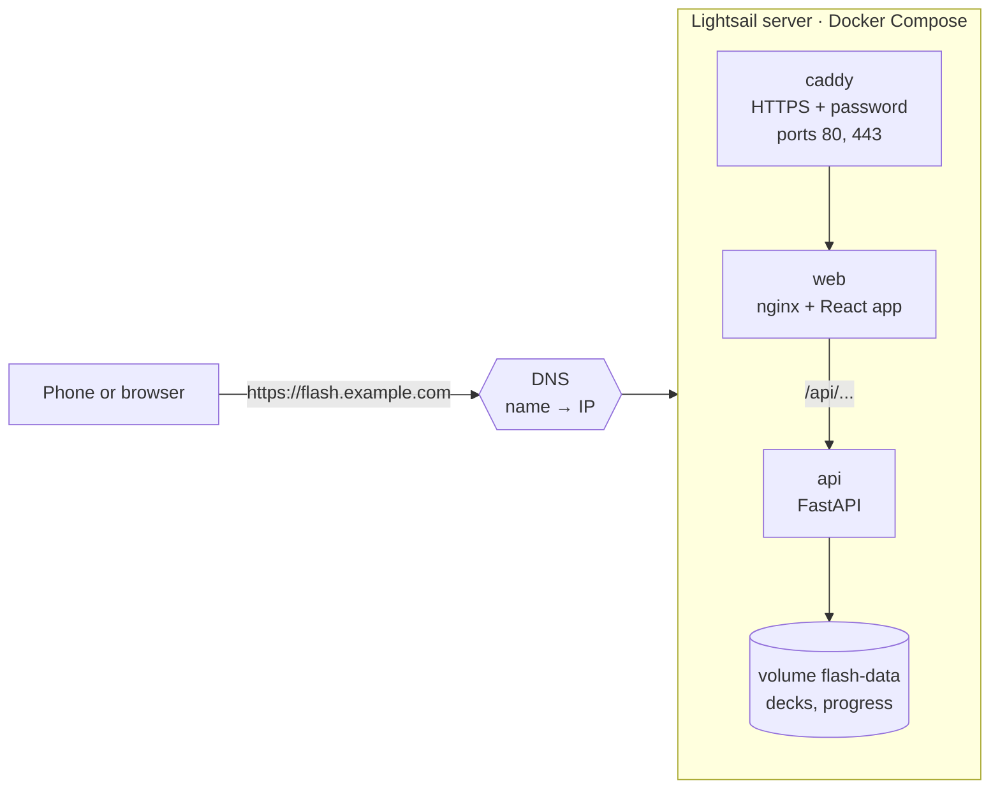

# Putting the web version online

This guide puts FlasH's web version on one small server, so students can open it on their phones from anywhere. It uses AWS Lightsail, but any Linux server with Docker works the same way: only steps 1 and 2 are AWS-specific.

The desktop app doesn't need any of this.



| Part | What it does |
|---|---|
| **DNS record** | Turns your domain (`flash.example.com`) into the server's IP address. |
| **Static IP** | The server's address. "Static" means it stays the same when the server restarts. |
| **caddy** | Gets a free HTTPS certificate (Let's Encrypt) and renews it by itself, and asks for the site password. |
| **web** | Serves the React app and passes `/api/...` to the API. |
| **api** | FlasH's logic. Not reachable from the internet directly. |
| **flash-data** | A Docker volume with all decks and progress. Back it up (step 8). |

## Before you start

- **The site needs a password.** FlasH has no user accounts yet: everyone who can open the site sees, adds and deletes the same decks. The setup below protects the whole site with one shared login.
- **You need a domain**, for example from Route 53 or any registrar (about $10–15 a year). HTTPS certificates are only issued for domain names, not for bare IP addresses.
- **Costs** (check current prices): a Lightsail server with 2 GB of memory is about $10–12 a month and includes its static IP and some traffic.

## 1. Create the server

1. In the [Lightsail console](https://lightsail.aws.amazon.com/), choose **Create instance**.
2. Platform **Linux/Unix**, blueprint **OS Only → Ubuntu** (the newest LTS).
3. Pick a plan with **at least 2 GB of memory**. Building the images needs it; 1 GB servers run out of memory during `npm` and `pip`.
4. Name it (for example `flash`) and create it.

## 2. Give it a fixed address and open the ports

1. **Networking** tab → **Create static IP** → attach it to the server. Note the IP, for example `3.120.45.67`.
2. In the server's **Networking** tab, under **IPv4 Firewall**, keep **SSH (22)** and **HTTP (80)**, and **add HTTPS (TCP 443)**. Optionally add **UDP 443** for HTTP/3.

Port 80 must stay open: Caddy uses it to prove to Let's Encrypt that you own the domain, and it redirects visitors to HTTPS.

## 3. Point your domain at the server

At your domain's DNS provider, add an **A record**:

| Type | Name | Value |
|---|---|---|
| A | `flash` (for `flash.example.com`) | your static IP |

Check it from your computer. It can take a few minutes to start working:

```bash
dig +short flash.example.com   # should print your static IP
```

## 4. Install Docker on the server

Connect with **Connect using SSH** in the console, or with `ssh ubuntu@<static IP>` using the key Lightsail gave you. Then:

```bash
sudo apt-get update && sudo apt-get -y upgrade
sudo apt-get install -y unattended-upgrades       # security updates install themselves
curl -fsSL https://get.docker.com | sudo sh        # Docker and Docker Compose
sudo usermod -aG docker "$USER"                    # use docker without sudo
exit                                               # log out and back in for that to take effect
```

After logging back in, `docker compose version` should print 2.24 or newer.

## 5. Get the code and configure it

```bash
git clone https://github.com/<owner>/FlasH.git
cd FlasH
cp .env.example .env
```

Make the password hash. This prints something starting with `$2a$14$`:

```bash
docker run --rm caddy:2.10-alpine caddy hash-password --plaintext 'the password students will use'
```

Edit `.env` (`nano .env`) and set:

```bash
FLASH_DOMAIN=flash.example.com
FLASH_USER=student
FLASH_PASSWORD_HASH='$2a$14$...the hash...'   # keep the single quotes
```

`.env` holds your settings and is ignored by git. Never commit it. The other values in it are optional limits; their defaults are fine.

## 6. Start it

```bash
docker compose up -d --build --wait
```

`.env` sets `COMPOSE_FILE`, so this one command starts all three containers with the production settings. The first build takes a few minutes. Then:

- open `https://flash.example.com`: the browser asks for the login, then shows FlasH;
- `curl https://flash.example.com/api/health` prints `{"status":"ok",...}` (this address is left open for uptime monitors);
- the API's docs are at `https://flash.example.com/api/docs`.

On a phone, open the address and choose **Add to Home Screen** in the browser menu.

## 7. Updating

On the server:

```bash
~/FlasH/deploy/update.sh          # newest code of the main branch
~/FlasH/deploy/update.sh my-branch
```

It pulls the code, rebuilds what changed, waits until every container is healthy, and removes old images.

### From GitHub, with one click (optional)

The **Deploy** workflow (`.github/workflows/deploy.yml`) runs the same script over SSH. Run it from **Actions → Deploy → Run workflow**. Set it up once:

1. On your computer, make a key only for deploying, and allow it on the server:

   ```bash
   ssh-keygen -t ed25519 -f flash_deploy -N "" -C "github deploy"
   ssh-copy-id -i flash_deploy.pub ubuntu@<static IP>
   ssh-keyscan <static IP>        # the server's host key, for DEPLOY_KNOWN_HOSTS
   ```

2. In the GitHub repo, **Settings → Secrets and variables → Actions**, add these **secrets**:

   | Secret | Value |
   |---|---|
   | `DEPLOY_HOST` | the static IP |
   | `DEPLOY_USER` | `ubuntu` |
   | `DEPLOY_SSH_KEY` | the contents of `flash_deploy` (the private key) |
   | `DEPLOY_KNOWN_HOSTS` | the output of `ssh-keyscan` |

   And optionally these **variables**: `FLASH_URL` (for example `https://flash.example.com`, to check the site answers afterwards) and `DEPLOY_PATH` (if the code isn't in `~/FlasH`).

3. Delete `flash_deploy` from your computer once it's saved in GitHub, or keep it somewhere safe.

Every collaborator of the repo can run workflows that use these secrets, so add them only to a repo whose collaborators you trust with the server.

## 8. Backups

Everything students add lives in the `flash-data` volume. Back it up:

```bash
~/FlasH/deploy/backup.sh                    # saves ~/flash-backups/flash-data-<date>.tar.gz, keeps the 14 newest
~/FlasH/deploy/backup.sh --restore ~/flash-backups/flash-data-20261121-030000.tar.gz
```

Run it every night with cron (`crontab -e`):

```
0 3 * * * /home/ubuntu/FlasH/deploy/backup.sh >> /home/ubuntu/flash-backups/backup.log 2>&1
```

A backup on the same disk dies with the disk, so also:

- turn on **automatic snapshots** for the server in Lightsail (**Snapshots** tab), and/or
- copy the files off the server now and then: `scp 'ubuntu@<static IP>:flash-backups/*.tar.gz' .`

## 9. Day to day

| Task | Command (in `~/FlasH`) |
|---|---|
| See what's running | `docker compose ps` |
| Follow the API's log | `docker compose logs -f api` |
| Restart everything | `docker compose restart` |
| Stop the site | `docker compose down` (data stays in the volume) |
| Change the password | new hash in `.env`, then `docker compose up -d` |

Logs are capped at 3 × 10 MB per container, so they can't fill the disk.

## Settings

All optional, in `.env`:

| Variable | Default | What it does |
|---|---|---|
| `FLASH_MAX_UPLOAD_MB` | 50 | Largest file a user may upload. nginx also stops anything over 50 MB (`frontend/nginx.conf`). |
| `FLASH_MAX_OPEN_TESTS` | 1000 | Unfinished tests kept in memory; the least recently used go first. |
| `FLASH_TEST_IDLE_HOURS` | 6 | An open test nobody touched for this long is forgotten. Its answers are already saved. |
| `FLASH_LOG_LEVEL` | INFO | `DEBUG`, `INFO`, `WARNING` or `ERROR`. |

## When something goes wrong

| What you see | Likely cause | What to do |
|---|---|---|
| The browser says the connection isn't private, or there's no certificate | DNS doesn't point at the server yet, or port 80/443 is closed | Check `dig +short <domain>` and the Lightsail firewall, then `docker compose logs caddy`. |
| The password is never accepted | The hash lost its `$` signs | Put the hash in single quotes in `.env`, then `docker compose up -d`. |
| "502 Bad Gateway" | The API isn't running or is unhealthy | `docker compose ps` and `docker compose logs api`. |
| "Can't reach the FlasH server" in the app | Same as above | Same as above. |
| The build stops with "Killed" | Not enough memory | Use a 2 GB server, or add swap: `sudo fallocate -l 2G /swapfile && sudo chmod 600 /swapfile && sudo mkswap /swapfile && sudo swapon /swapfile`. |
| "File is too large" | Upload over the limit | Raise `FLASH_MAX_UPLOAD_MB` and `client_max_body_size` in `frontend/nginx.conf` together. |

## Security checklist

- [ ] The site password is set and not shared publicly.
- [ ] `.env` and the deploy key are not in git.
- [ ] Only ports 22, 80 and 443 are open.
- [ ] SSH logins use keys (the Lightsail default), not passwords.
- [ ] `unattended-upgrades` is installed, and `deploy/update.sh` is run after Dependabot updates are merged.
- [ ] Backups run every night and a copy is kept off the server.
- [ ] Remember: there are no user accounts, so everyone with the password shares the same decks.

## Why one server and not more AWS services

FlasH stores decks as files and keeps open tests in the API's memory, so it must run as **one** API process with a disk. That rules out services that start many copies or have no lasting disk (App Runner, Lambda), and it makes ECS + EFS + a load balancer cost more than the whole server. Once storage moves to a database (`flash/storage` is built for that), the API can run as several copies behind a load balancer, and the web app can move to S3 + CloudFront.
